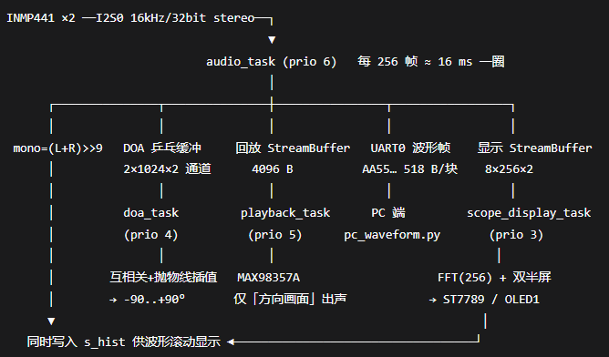
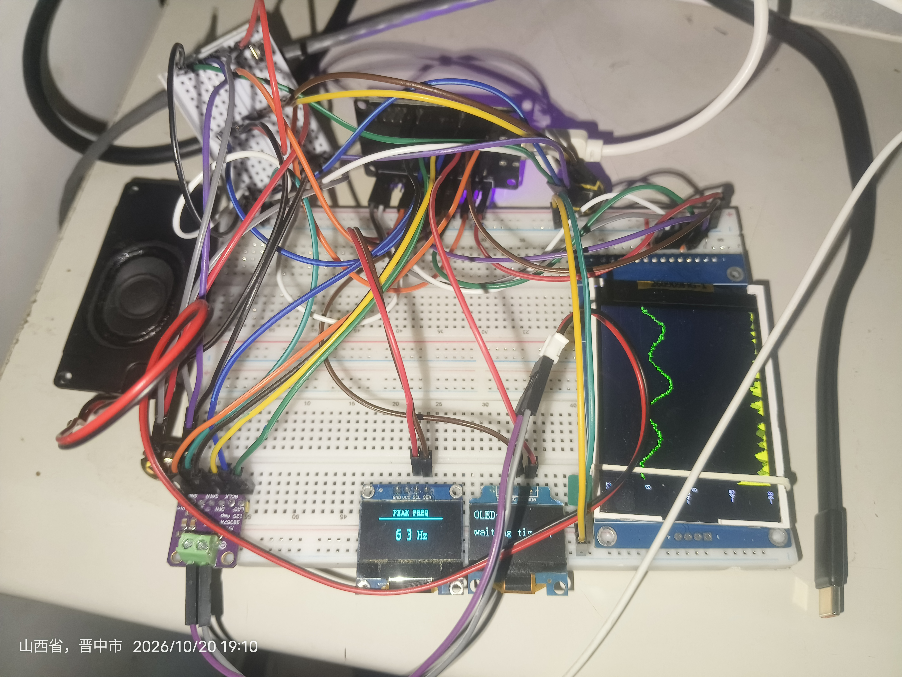
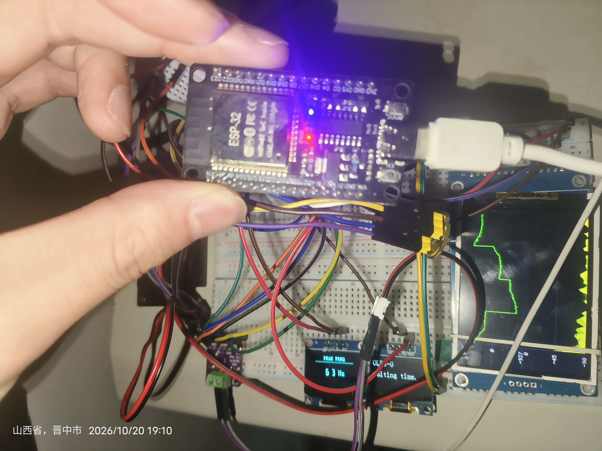
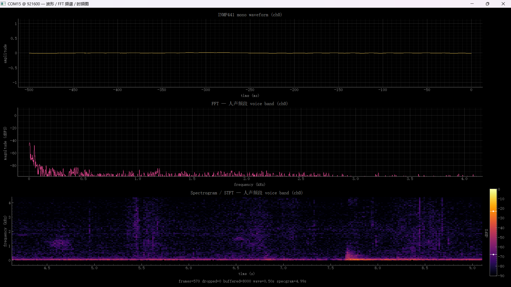
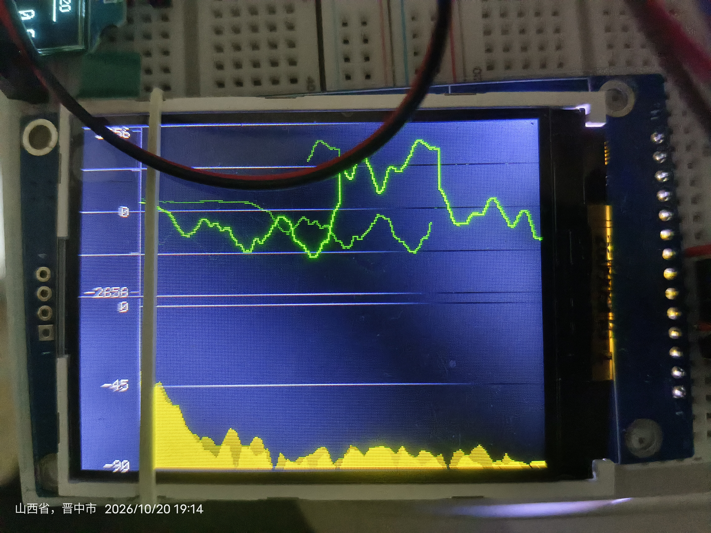
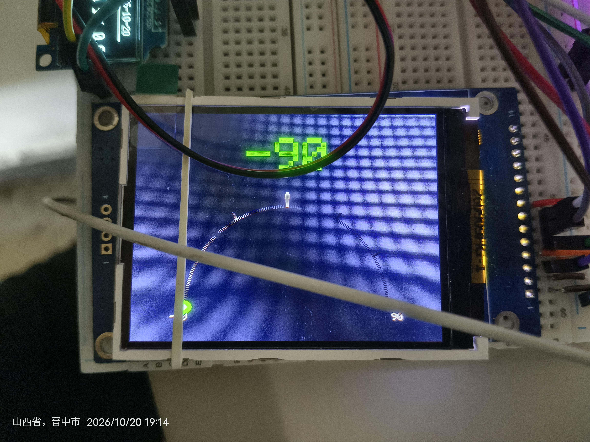
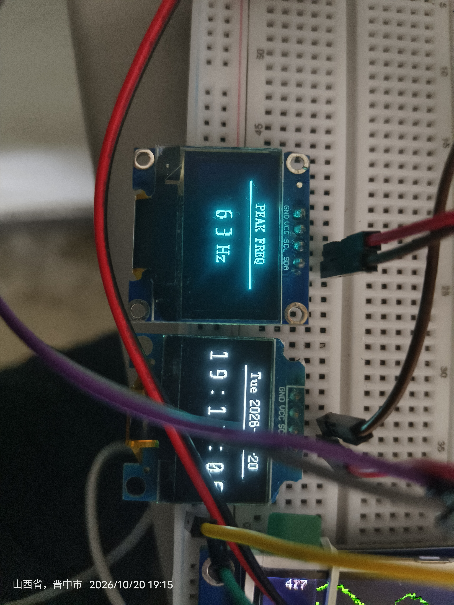

# sample_project

基于 ESP-IDF 的 ESP32 音频可视化项目：双麦克风拾音 + 声源方位估计（DOA）、实时波形 / FFT 频谱示波、OLED 信息显示，以及串口波形透传到电脑。

<!--
  图片说明：所有插图位于 `images/` 目录，使用相对路径引用。
  新增图片建议长边 ≤1200px，避免仓库体积过大。
-->

## 功能特性

- **双麦克风拾音**：两片 INMP441 并联构成 I2S 立体声输入，16 kHz 采样。
- **声源方位估计（DOA）**：基于左右声道互相关时延估计方位角（-90° ~ +90°）。
- **实时回放**：MAX98357A I2S DAC 功放；处于「收音方向」画面时麦克风信号直通输出，示波器画面主动静音（避免功放输入悬空产生杂音）。
- **TFT 示波器**：2.8 寸 ST7789V（驱动沿用 ILI9341 命名）横屏显示，波形 + FFT 频谱，短按按键切换到「收音方向」画面。
- **双 OLED 显示**：两块 SSD1306 走两条独立 I2C 总线，一块显示同步时钟、一块显示 FFT 峰值频率。
- **串口波形透传**：UART0（921600）把音频样本打包成帧发给电脑，配合 `tools/pc_waveform.py` 实时绘图。
- **时间同步**：电脑端每秒下发系统时间，显示到 OLED。

## 整体架构



```
INMP441 双麦克风 ──I2S0──> audio_task（采集 / 混 mono / 分发）
                                 │
                                 ├─> doa_task ──────────> 互相关估计方位角
                                 ├─> playback_task ─────> MAX98357A（仅方向画面出声）
                                 ├─> scope_display_task ─> ST7789V + 双 SSD1306
                                 └─> UART0 ─────────────> pc_waveform.py
```

## 硬件组成

| 模块 | 型号 | 数量 | 说明 |
|------|------|------|------|
| 主控 | ESP32 | 1 | ESP-IDF 5.3.4 |
| 麦克风 | INMP441 | 2 | I2S 立体声，L/R 并联 |
| 功放 | MAX98357A | 1 | I2S DAC + 功放 |
| 屏幕 | ST7789V 2.8" 240×320 | 1 | TFT 示波器 |
| 屏幕 | SSD1306 128×64 | 2 | OLED 信息显示 |
| 按键 | 轻触开关 | 1 | 切换示波器 / 方向画面 |





## 引脚接线

### INMP441 麦克风（两片并联）

| 信号 | GPIO |
|------|------|
| BCK | 14 |
| WS（L/R） | 15 |
| DOUT（两片并联到 DIN） | 22 |

> 两片 INMP441 的 BCK / WS 共用，DOUT 一起接到 GPIO22；通过 L/R 引脚分别接 GND / VDD 区分左右声道。

### MAX98357A 功放

| 信号 | GPIO |
|------|------|
| BCK | 26 |
| WS | 25 |
| DIN | 27 |
| SD（使能，可选） | 32 |

### ST7789V TFT（驱动沿用 ILI9341 命名）

| 信号 | GPIO |
|------|------|
| SCLK | 18 |
| MOSI | 23 |
| CS | 5 |
| DC | 4 |
| RST | 未接 MCU（接 VCC） |
| BL（背光） | 2 |

### SSD1306 OLED（两条独立 I2C 总线）

| 屏幕 | SDA | SCL | I2C 总线 |
|------|-----|-----|----------|
| OLED-0（时钟） | 13 | 16 | I2C_NUM_0 |
| OLED-1（FFT 峰值） | 17 | 19 | I2C_NUM_1 |

### 按键

| 引脚 | 说明 |
|------|------|
| GPIO21 ↔ GND | 短按切换示波器 / 方向画面（低电平有效，内部上拉） |

## 目录结构

```
.
├── main/
│   ├── main.c            # 主入口、任务编排与缓冲
│   ├── audio_config.h    # 音频 / DOA / 回放全局参数
│   ├── inmp441_doa.c/.h  # INMP441 采集 + DOA 方位估计
│   ├── max98357.c/.h     # MAX98357A 功放回放
│   ├── ili9341.c/.h      # TFT (ST7789V) 驱动与绘图
│   ├── scope_display.c/.h# TFT 示波器（波形 + FFT + 方向）
│   ├── oled_display.c/.h # 双 SSD1306 OLED
│   ├── share_tech_mono.h # 时钟显示用 16x16 点阵字模
│   ├── uart_stream.c/.h  # UART 波形透传
│   ├── time_sync.c/.h    # 时间同步
│   ├── idf_component.yml # 组件依赖清单
│   └── CMakeLists.txt
├── tools/
│   └── pc_waveform.py    # 电脑端实时波形 / 频谱 / 时频图
├── images/               # README 插图
├── flash.ps1             # 一键烧录（清理端口占用 + idf.py flash）
├── CMakeLists.txt
├── dependencies.lock     # 组件管理器锁定文件
└── README.md
```

> `sdkconfig` 由 `idf.py set-target` 在本地生成，已列入 `.gitignore`，不随仓库分发；`.vscode/`、`.devcontainer/`、`.claude/` 为编辑器 / 工具配置，与固件无关。

## 环境要求

- **ESP-IDF**：`main/idf_component.yml` 声明 `idf >= 5.0`。实际验证版本为 **5.3.4**；`dependencies.lock` 记录的是生成该文件时的 **6.1.0**，其他版本未逐一验证。
- **目标芯片**：`esp32`
- **依赖组件**：`espressif/ssd1306 1.0.5~1`（由组件管理器自动拉取）
- **本机配置**：`flash.ps1` 的 IDF 路径与串口、`.vscode/settings.json` 的 `idf.espIdfPathWin` / `idf.port` 均为作者本机值，首次使用请改成自己的环境。

## 构建与烧录

```bash
# 设置目标芯片（首次）
idf.py set-target esp32

# 编译
idf.py build

# 烧录并打开串口监视器
idf.py -p COMx -b 921600 flash monitor
```

> `COMx` 替换为实际串口号。日志已重定向到 921600，**监视器必须显式指定波特率**，否则看到的是乱码；分开执行时用 `idf.py -p COMx monitor -b 921600`。

## 使用方法

1. 上电后，两块 OLED 分别显示自己的编号和接线，便于核对 SDA/SCL。
2. TFT 默认显示波形 + FFT 频谱示波器；短按 GPIO21 按钮切换到「收音方向」画面，再按切回。
3. OLED-0 在收到电脑时间后自动切换为实时时钟显示。

### 电脑端波形显示

```bash
cd tools
pip install pyserial numpy pyqtgraph pyqt5

python pc_waveform.py                 # 自动枚举串口
python pc_waveform.py COM5            # 指定串口（921600 / 16 kHz）
python pc_waveform.py --selftest      # 编解码自测（无需硬件/串口）
```



## 显示界面







## 串口协议（简要）

- **上行波形帧**（ESP32 → PC）：`[0xAA 0x55][channels u8][frames u16][int16 样本 ...][checksum u8]`，小端。
- **下行时间帧**（PC → ESP32）：`[0x55 0xAA][cmd=0x01][year u16][month][day][hour][min][sec][checksum]`，共 11 字节小端。

协议实现详见 `main/uart_stream.c`、`main/time_sync.c` 与 `tools/pc_waveform.py`。

## 参数配置

采样率、块大小、DOA 参数（麦克风间距、静音门限等）与回放缓冲大小，集中在 `main/audio_config.h`。麦克风间距 `MIC_SPACING_M` 需按实际安装距离调整。